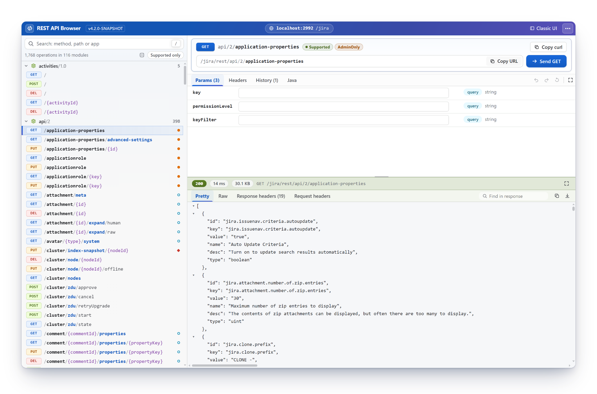
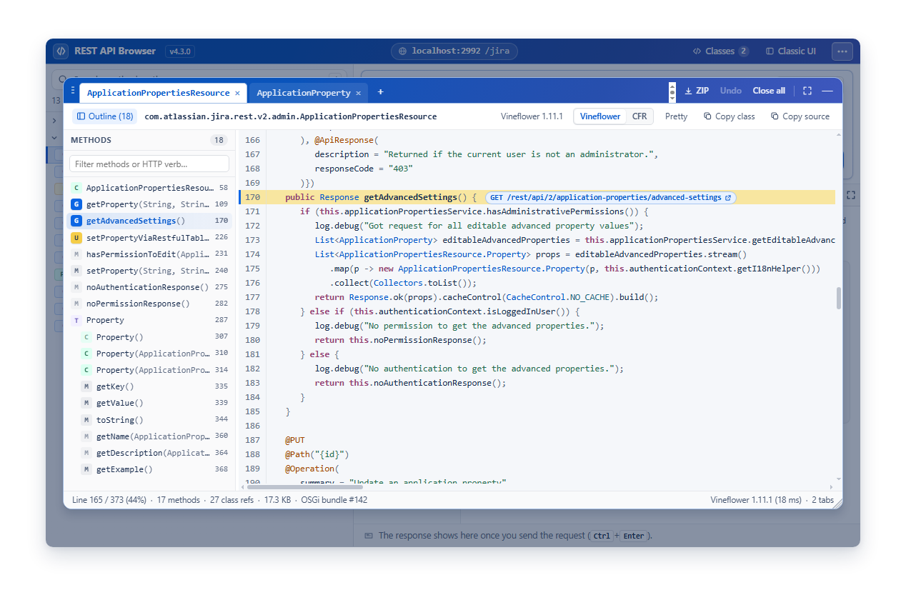

REST API Browser
================

> [!NOTE]
> An unofficial, maintained fork of Atlassian's archived REST API Browser, for Jira 11, Confluence 10 and the other
> Data Center products of Platform 8. See [About this fork](#about-this-fork).

## Description

REST API Browser is an app for **Atlassian Data Center** products, the self-managed editions that run on your own
servers (Jira, Confluence, Bitbucket, Bamboo, Crowd). It does not work on Atlassian Cloud: Cloud apps are built
differently and Cloud's REST APIs are documented on [developer.atlassian.com](https://developer.atlassian.com).

Installed in a product, it lists the REST APIs of that instance: the product's own, those of its bundled apps and
those of the apps you installed, including private and undocumented ones. Pick an endpoint to see its parameters,
fill them in and send the request from the browser, with your own session and permissions. It is meant for
administrators and app developers who need to know what an instance really offers.

## Screenshots

<p align="center">
  <br />
  <sub>The new UI (a preview, since 4.2.0) on Jira 11.3: every REST operation of the product and its apps, grouped by module, with the form and the response beside it.</sub>
</p>

<p align="center">
  <br />
  <sub>Embedded Java decompiler (since 4.3.0, sysadmin only): floating tabbed window with Vineflower 1.11.1 (default) and CFR 0.152 switching, method outline with REST verb badges, clickable class references, inline endpoint links and ZIP export.</sub>
</p>

## Compatibility

Which release to install depends on the product's version:

| Product | This fork (latest release) | Atlassian's 3.2.8 |
|---|---|---|
| Jira | 11.x, tested on 11.3.13 | 9.4 – 10.x |
| Confluence | 10.x, tested on 10.2.20 (see below) | 7.19 – 9.x |
| Bitbucket | 10.x, untested | 8.9 – 9.x |
| Bamboo | 12.x, untested | 9.2 – 10.x |
| Crowd | 7.x, untested | 6.x |
| Fisheye / Crucible | not supported | 4.8 |

- **Untested** products are built on the same Atlassian platform as Jira 11 and Confluence 10
  ([Platform 8](https://developer.atlassian.com/platform/marketplace/dc-apps-platform-8): Spring 6, Jakarta EE 10,
  Java 21), so the fork should run on them too. Fisheye and Crucible were not moved to it. The next major versions
  (Jira 12, Confluence 11, Bitbucket 11, Bamboo 13, Crowd 8) move to Spring 7 and Jakarta EE 11, so the fork may not
  run on them.
- **Confluence 10** needs 4.1.1 or later: 4.0.5 and 4.1.0 answer 500 there. Confluence 10.2.20 does not ship JAXB's
  `txw2`, so 26 of its REST modules (including `/rest/api`) cannot render WADL documents and fail with 500. Since
  4.4.0, when classic WADL requests fail, the sidebar shows those modules with a link to inspect them in the new UI.
  Copying `txw2-4.0.5.jar` (`org.glassfish.jaxb:txw2:4.0.5` on Maven Central) into `confluence/WEB-INF/lib` and restarting
  restores full WADL generation as well, though Atlassian does not support this change.
- **Atlassian's 3.2.8** (July 2024) is Atlassian's last release. It is in Atlassian's Maven repository but no longer on
  the Marketplace. Its range starts at the oldest versions its build declares as supported and ends at the Platform 7
  versions, which Atlassian's archived repository assigns to its `3.2.x` branch. Atlassian never released a final
  4.0.0, the version this fork is based on.

## Install

Download `rest-api-browser-<version>.jar` from [Releases](https://github.com/rdk/rest-api-browser/releases) (or
[build](#build) it), then upload it in the product under **Manage apps → Upload app**. Products disable uploads by
default: start the product with the JVM flag `-Dupm.plugin.upload.enabled=true` first. The plugin keeps Atlassian's
plugin key, so it replaces Atlassian's REST API Browser if that is installed.

## Usage

Clicking **REST API Browser** in the Jira or Confluence administration menu opens the decorated Admin Intro page at
`<base URL>/plugins/servlet/rest-api-browser/admin`, which provides a prominent launch button for the full-screen UI,
live agent/MCP URLs, MCP client configuration, and ready-to-copy debugging prompts.

You can also open the full-screen [new UI (preview)](#new-ui-preview) directly at
`<base URL>/plugins/servlet/rest-api-browser` (the legacy `/plugins/servlet/restbrowser/next` URL redirects there), or
the classic UI at `<base URL>/plugins/servlet/restbrowser` (`<base URL>/restbrowser`). In the classic UI, the sidebar
lists the REST resources of the product and its apps (**Show only public APIs**, on by default, limits it to public
APIs), and **Send** executes the request as the logged-in user.

For automation and AI agents, the plugin serves [llmstxt.org](https://llmstxt.org/) guides at
`<base URL>/plugins/servlet/rest-api-browser/llms.txt` and `llms-full.txt`, OpenAPI 3.1.0 at
`/rest/restbrowser/1/openapi.json`, and a built-in read-only MCP endpoint at `/rest/restbrowser/1/mcp`; see
[Agent API, OpenAPI 3.1 & MCP](#agent-api-openapi-31--mcp).

Users who are not logged in are sent to the login page. Starting the product with `-Drest.api.browser.anonymous=true`
lets them use the classic page too, so anyone who can reach the product can open it. The new UI ignores that switch:
it lists every endpoint and app of the instance, so it needs a user with a product license.

## New UI (preview)

Open `<base URL>/plugins/servlet/rest-api-browser` as a licensed user. It is a second page next to the classic one,
which stays as it is.

It works differently: the server builds a catalog of the product's REST API from Jersey's runtime model (served at
`/rest/restbrowser/1/catalog`), so the browser fetches and parses no WADL. That is why it works on Confluence 10, where
the classic page's public list is empty. It reads OpenAPI / Swagger annotations (`@Operation`, `@Parameter`) into
summaries, descriptions and parameter hints, supports URL-encoded form parameters (`@FormParam`) and multipart file
uploads (`@MultipartFormParam`), JSON response formatting with long-line **View full** modal and **Wrap** toggle, search,
a history of sent requests, **Copy as curl**, per-module **OpenAPI 3.1** downloads (operation header and pinned
module card), **Generate example** DTO JSON payloads on the **Body** tab, and deep links that prefill a request
without sending it (`?op=...`, `?supportedOnly=1`, or sysadmin `?class=...&method=...&line=...` to open the decompiler
directly). When running in a cluster or alongside [Live Scalpel](https://github.com/rdk/live-scalpel), the header shows
the current `nodeId` badge and a **Trace in Scalpel** deep link on operations. System administrators also get clickable Java
input/output/parameter types with rich hover cards
(OSGi bundle wiring, plugin ownership and timestamps, classloader, bytecode info), a **Java** tab per operation with
virtualized on-demand method and full class decompilation (focusing the method declaration header), and a
draggable/resizable/maximizable persistent tabbed decompiler window with CFR 0.152 / Vineflower 1.11.1 switching,
in-dialog **Impls**, **Callers**, **Grep**, and **Files** bundle intelligence panels with inline text/XML preview, and
undoable tab closing (disable decompilation with `-Drest.api.browser.decompile=false`). See
[Agent API, OpenAPI 3.1 & MCP](#agent-api-openapi-31--mcp) and [docs/NEW-UI-PLAN.md](docs/NEW-UI-PLAN.md).

**Modules that have not started.** Confluence starts a REST module only on the first request to it, on each node of a
cluster, so right after a node starts most of its modules cannot be read yet, Confluence's own `/rest/api` included.
The list shows them as *not started · start*. Selecting one sends an OPTIONS request to a path the module does not
have, which starts the module on that node (Jersey usually answers it with a 404; the request passes the module's
filters like any other). The plugin then checks that the module runs and reads that module alone, without rebuilding
the catalog (`POST /rest/restbrowser/1/catalog/started`). Modules that only initialize for their own authentication
channel (such as token-auth endpoints returning 401/403) are remembered on that node as *needs its own login* (`409` on
`/catalog/started`) so they do not keep re-prompting, and background catalog build failures retry automatically with
bounded backoff. On Jira the catalog can start a module itself, through the product's servlet module manager, so this
does not come up there.

Hover a module or an operation for a card that explains its marks and, for a module that could not be read, the
reason; hover the response's status code for what it means and what to try.

## Agent API, OpenAPI 3.1 & MCP

Alongside the web UI, the plugin exposes a token-efficient API for AI agents and scripts using standard browser
cookies, Basic auth, or Jira/Confluence Personal Access Tokens (`Authorization: Bearer <token>`):

- **Discovery & OpenAPI 3.1.0**:
  - `/plugins/servlet/rest-api-browser/admin` renders the product-decorated admin onboarding page with the full-screen UI
    launch button, live URLs tailored to the instance, MCP JSON config, and copyable example prompts.
  - `/plugins/servlet/rest-api-browser/llms.txt` and `llms-full.txt` provide quick and detailed bootstrap guides
    (`@AnonymousSiteAccess` — generic guide anonymously, instance metadata for licensed callers).
  - `/rest/restbrowser/1/openapi` (also `/openapi.json`) serves a role-filtered OpenAPI 3.1.0 spec of REST API
    Browser's own endpoints; `/rest/restbrowser/1/catalog/openapi?module={id}` generates an OpenAPI 3.1.0 spec on
    demand for any indexed REST module (with DTO schemas for sysadmins).
- **Catalog & Code Intelligence (`/rest/restbrowser/1/*`)**:
  - **Catalog** (`@LicensedOnly`): ultra-compact plain-text cluster/module triage brief (`GET /catalog/brief` /
    `?format=brief`), server-side scored search (`/catalog/operations`, including `?usesClass=` and
    `?format=markdown`), JAX-RS template URL matching (`/catalog/resolve?url=...`), and `/catalog/index/current`.
  - **Code & OSGi** (`@SystemAdminOnly`): one-shot `POST /code/context` (metadata + DTO schemas + decompiled handler +
    OSGi implementations, with `maxChars` truncation budget), Draft 2020-12 JSON Schema & examples (`/code/schema`),
    bytecode outlines and inline service hints (`/code/class`), live OSGi implementations (`/code/implementations`),
    constant-pool callers and grep (`/code/callers`, `/code/grep`), safe bundle resource reader (`/code/resource`),
    typed BFS reference graphs (`/code/graph?preset=domain`), and Vineflower 1.11.1 / CFR 0.152 decompilation
    (`/code/source`). Most read endpoints support `ETag` / `If-None-Match` (`304`) and `format=markdown` (`Accept:
    text/markdown`).
- **Zero-Dependency Python Client ([`client/rab.py`](client/rab.py))**:
  - Python 3.9+ stdlib CLI (`brief`, `search`, `resolve`, `context`, `source`, `schema`, `impls`, `callers`, `grep`,
    `graph`, `resource`, `plugin`, `mcp`) with `RAB_URL` / `RAB_TOKEN` support, sticky session cookies, automatic XSRF
    headers, and default `--max-chars 6000` output clipping.
- **Built-in Read-Only MCP Server (`POST /rest/restbrowser/1/mcp`)**:
  - Streamable HTTP JSON-RPC 2.0 exposing read-only `tools/*` (4 catalog tools for licensed users, 16 tools for system
    administrators, all supporting optional `maxChars` output clipping), `resources/*` (`rab://llms.txt`,
    `rab://llms-full.txt`, `rab://catalog/brief`, `rab://catalog/summary`, `rab://openapi/self`, plus URI templates for
    module OpenAPI specs and sysadmin class/source/plugin inspection), and `prompts/*` workflows over PAT
    authentication (and ready to pair with Live Scalpel's dual-MCP config shown on the Admin Intro page):

```json
{
  "mcpServers": {
    "rest-api-browser": {
      "url": "https://your-instance/rest/restbrowser/1/mcp",
      "headers": {
        "Authorization": "Bearer <PERSONAL_ACCESS_TOKEN>"
      }
    }
  }
}
```

Full endpoint parameters, MCP tool inventory, caching rules, and `curl` examples: [docs/AGENT-API.md](docs/AGENT-API.md).

## Open work

[TODO.md](TODO.md) is the short list of open work; each item has its own file in [docs/todo/](docs/todo/), and
[docs/todo/README.md](docs/todo/README.md) has the conventions. The rest of `docs/` is listed in
[docs/README.md](docs/README.md).

## About this fork

Atlassian archived [its repository](https://bitbucket.org/atlassian/rest-api-browser) at 4.0.0, a milestone for
Platform 8 (Spring 6, Jakarta EE 10, Java 21) that was never released, with this notice: *"This repository is no longer
in active use. Branch 3.2.x is still used together with Platform 7 and should EOL at the same time."* This fork starts
from that 4.0.0:

- It builds again, against Platform 8.0.0 instead of the 8.0.0-m01 milestone, which no longer resolves.
- It is tested on Jira 11.3.13 and Confluence 10.2.20, including a two-node Jira Data Center; see [Testing](#testing).
- It adds fixes for those products (Confluence 10, the classic page's path parameters and descriptions) and a
  [new UI](#new-ui-preview).
- It keeps Atlassian's plugin key and Apache License 2.0. It is not supported by Atlassian.

## Build

Needs JDK 21 and Maven 3.9; `pom.xml` declares Atlassian's public Maven repository, where the dependencies are. The
first build also needs network access: the frontend-maven-plugin downloads Node 24 into `target/` and the npm
packages of the new UI. `src/main/frontend` holds its TypeScript sources (`npm test`, `npm run build` there).

```bash
mvn -B clean package -DskipTests   # target/rest-api-browser-<version>.jar
mvn -B verify                      # also runs the integration test against the refapp
```

GitHub Actions builds every push. Pushing a tag such as `4.0.5` (the version in `pom.xml`) builds that jar and
creates a draft release with it.

## Testing

`mvn verify` runs the integration test against the refapp, and the CI workflow plus local `npm run test:mock` exercise
the built Preact UI without a running Jira/Confluence server via the offline browser harness
([`src/test/harness/index.html`](src/test/harness/index.html)) and
[`src/test/product/e2e-mock/`](src/test/product/e2e-mock/harness.spec.ts). To check the plugin on a real Jira Data
Center (Jira 11.3.13 by default), see [src/test/product/README.md](src/test/product/README.md); with
`RAB_PRODUCT=confluence` the same scripts and Playwright E2E suite check it on Confluence 10.2.20:

```bash
mvn -B clean package -DskipTests                   # target/rest-api-browser-<version>.jar
python -B -m unittest discover -s client -v        # Python CLI client tests (stdlib only)
(cd src/test/product && npm run test:mock)         # offline mock UI Playwright E2E suite
src/test/product/product.sh start
python src/test/product/smoke.py --expect-version 11.3.13
python src/test/product/mcp_pat_check.py             # MCP tools, resources, prompts over PAT auth
(cd src/test/product && npm test)                  # Playwright E2E suite (Jira & Confluence)
node src/test/product/ui.js                        # zero-dependency CDP fallback (no npm packages)
node src/test/product/ui_next.js                   # zero-dependency CDP full suite (no npm packages)
src/test/product/product.sh stop
```

## Changing the JavaScript

Outside dev mode the page loads `src/main/resources/assets/rab/rest-api-browser.min.js`, a bundle of the scripts listed
in `Gruntfile.js` next to it, which the Maven build does not regenerate. After changing a script, rebuild the bundle and
commit only the `.min.js`:

```bash
cd src/main/resources/assets/rab
npm install && npx grunt
```

In dev mode (`-Datlassian.dev.mode=true`, which the Atlassian Plugin SDK sets for the products it starts) the page loads
the scripts one by one instead. Since 4.1.0 the bundle holds the same scripts as dev mode, including underscore and
Atlassian's 2024 change to `process-wadl.js`; 4.0.5 and earlier ship a bundle built in 2020.

## License

Apache License 2.0, see [LICENSE](LICENSE). The original code is © Atlassian.
